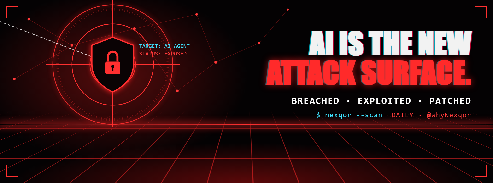

<h1 align="center">NEXQOR</h1>

<h3 align="center">AI IS THE NEW ATTACK SURFACE</h3>

<p align="center">
  I break down the hacks, the leaks and the patches. Daily.<br/>
  Plain language. Real incidents. What to do on Monday morning.
</p>

<p align="center">
  <a href="https://x.com/whyNexqor"></a>
  
  
</p>

---

```text
$ whoami
nexqor — cyber analyst, writer, signal over noise

$ cat focus.txt
[+] attacks on AI systems ........ prompt injection, jailbreaks, data poisoning
[+] breaches & leaks ............. who got hit, how, and what it cost
[+] patches & CVEs ............... what to update today, what can wait
[+] defense on a budget .......... the $20 attacker vs. the $2M defender
```

## What I cover

**🛡️ AI security**
- Prompt injection and agent hijacking
- LLM data leaks and model supply chain risks
- Where AI agents become an attacker's best friend

**💥 Incidents, broken down**
- Fresh breaches and ransomware campaigns
- The attack chain, step by step
- The one control that would have stopped it

**🔧 Patches & practice**
- Critical CVEs worth your attention
- SOC, EDR and detection tactics
- Tools for defenders, free and open source

## Featured

> **The Attacker Spends $20. You Spend $2 Million. That Gap Decides 2027.**
> Why perimeter, EDR and MFA are not enough anymore, and what closes the gap.
> → read it on [X](https://x.com/whyNexqor)

## Projects

| Project | What it is |
|---|---|
| [`awesome-ai-security`](https://github.com/Nexqor/awesome-ai-security) | Frameworks, red team tools, guardrails, papers + sourced 2026 AI incident timeline |
| [`ai-attack-playbook`](https://github.com/Nexqor/ai-attack-playbook) | 9 attacks on AI: how they work, real examples, detection, defense |
| [`nexqor-tools`](https://github.com/Nexqor/nexqor-tools) | Prompt injection scanner for RAG, agents and web content |
| [`mcp-audit`](https://github.com/Nexqor/mcp-audit) | Static security audit for MCP configs: secrets, unpinned servers, auto-approve, tool poisoning |
| [`ai-detection-rules`](https://github.com/Nexqor/ai-detection-rules) | Sigma rules for LLMjacking, agent credential theft, exfiltration, MCP tampering |
| [`rag-canary`](https://github.com/Nexqor/rag-canary) | Canary tokens that pinpoint which RAG document leaked |
| [nexqor.github.io](https://nexqor.github.io) | AI security news, playbook, free scanner, glossary |

⭐ Star the repos to follow new attacks and tools.

## Connect

**X:** [@whyNexqor](https://x.com/whyNexqor): daily breakdowns
**Site:** [nexqor.github.io](https://nexqor.github.io): news, playbook, scanner
**GitHub:** [Nexqor](https://github.com/Nexqor)

<p align="center"><sub>Signal over noise. Educational content for defenders.</sub></p>
